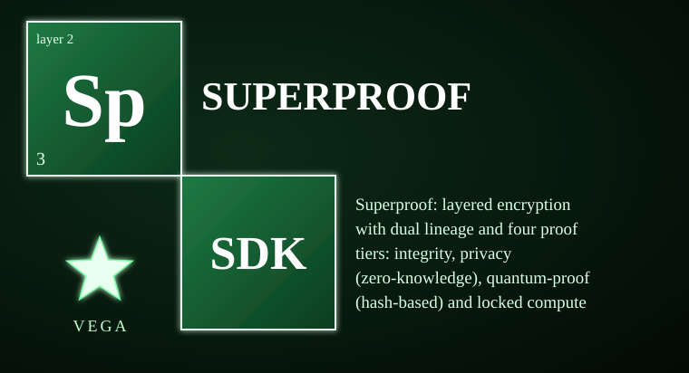

# vega-superproof-sdk

Superproof: layered encryption with dual lineage and four proof tiers: integrity, privacy (zero-knowledge), quantum-proof (hash-based) and locked compute with updating encryption.

> **Licensing.** Source-available, not open source. Free for personal use; free for registered small businesses (under US$1M revenue and valuation); everyone else needs a commercial license (see LICENSE; for a commercial license write to jasonblasiak.ai.mail@gmail.com). Patent pending. Draft licence text, not yet reviewed by an attorney.

Package: `vega_superproof` (src layout). Depends on: vega-custody-sdk.

## Modules

| Module | What it does |
|---|---|
| `seal` | AES-256-GCM then ChaCha20-Poly1305, dual lineage, signed top root, Shamir key split, presets, key ratchet and re-seal. |
| `zk` | Privacy tier: Schnorr proof of knowledge, Pedersen commitments, range and at-least proofs (a number is at least X without showing it), issuer attestation. Plain Python on secp256k1. |
| `hashsig / disclosure` | Quantum-proof tier: a stateful hash-based signature (Winternitz keys under a Merkle tree, SHA-256 only) and salted Merkle selective disclosure. |
| `lwe` | Locked compute: a learning-with-errors scheme that adds, subtracts and scales numbers while encrypted, with key rotation by a switch key and epoch numbers. |
| `builtin` | The working backends for tiers 1 to 3, enabled on purpose; an un-enabled tier still fails closed. |

## What it does NOT do (read this)

- The zero-knowledge, hash-signature and LWE code is plain Python, not constant-time, and has had no independent cryptographic review: do not protect real secrets with it before one.
- The LWE scheme is additive only: no encrypted comparisons and no ciphertext-times-ciphertext products, so it is not fully homomorphic.
- Quantum-proof here means the seal rests only on hashes and 256-bit symmetric keys; the zero-knowledge tier relies on the discrete log and is not quantum-proof.
- The hash signature is stateful: each key is used once and the state file must never be copied or restored from an old backup.
- Tier 0 is a hash-binding proof: integrity and binding, not zero-knowledge. It never fakes a proof and never silently downgrades.

## Status

See STATUS.md. Tests: 95 tests in 4 files, all passing.  See SECURITY.md for the threat model.

## Run the tests

Put `src` of this repo and of the repos it depends on on PYTHONPATH, then run each file in `tests/`.
